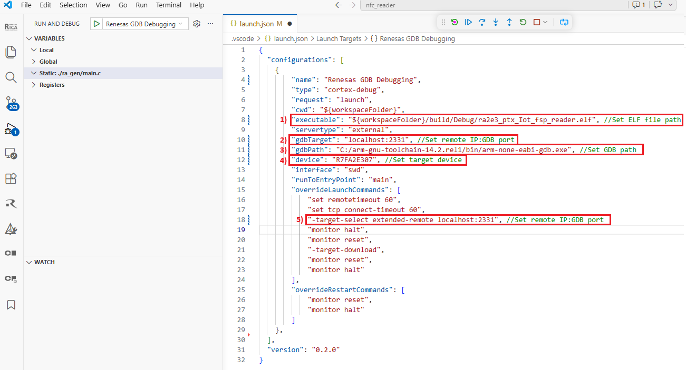
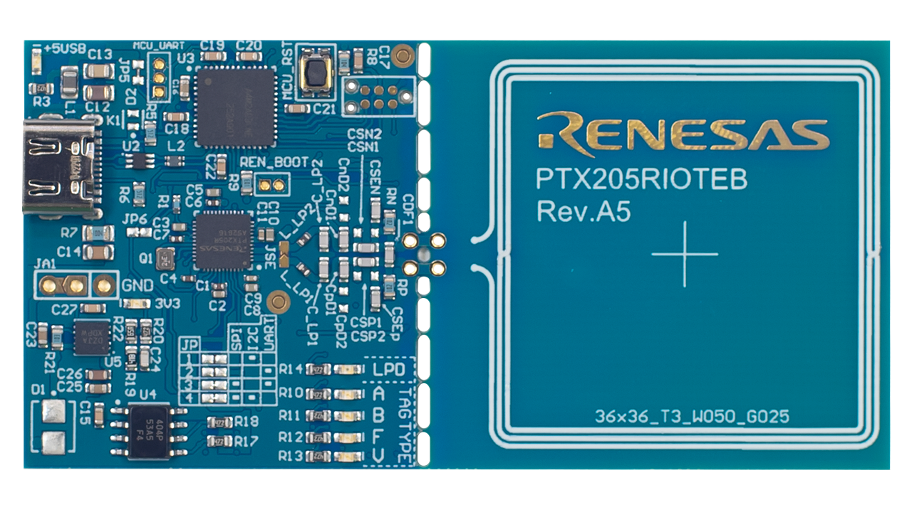
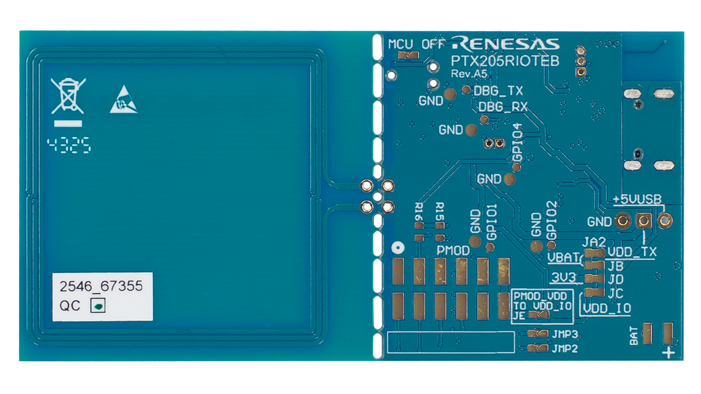
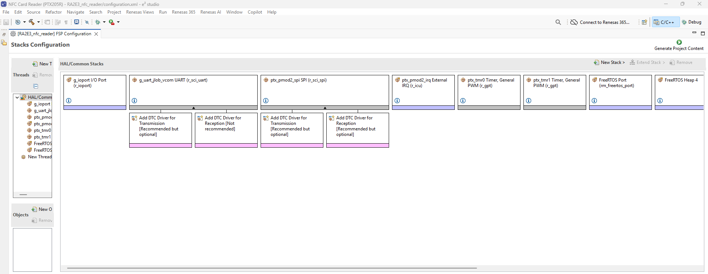
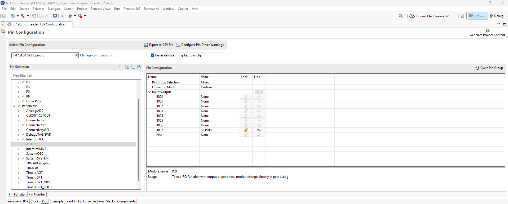
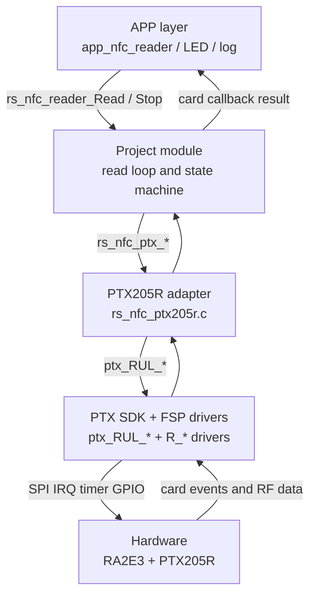
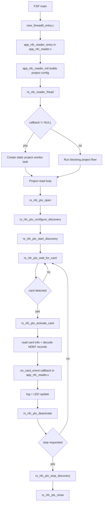
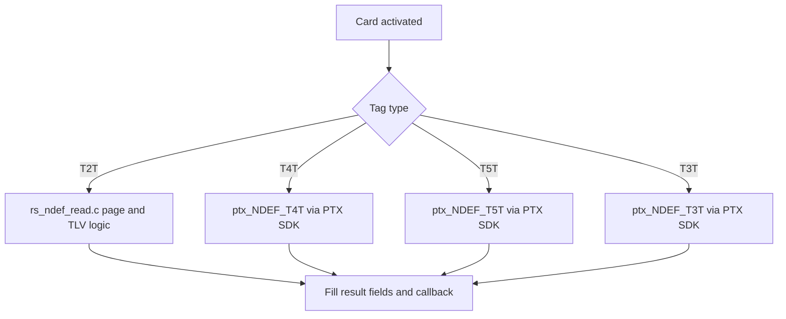
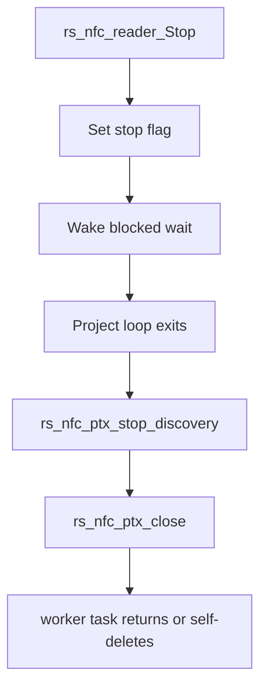
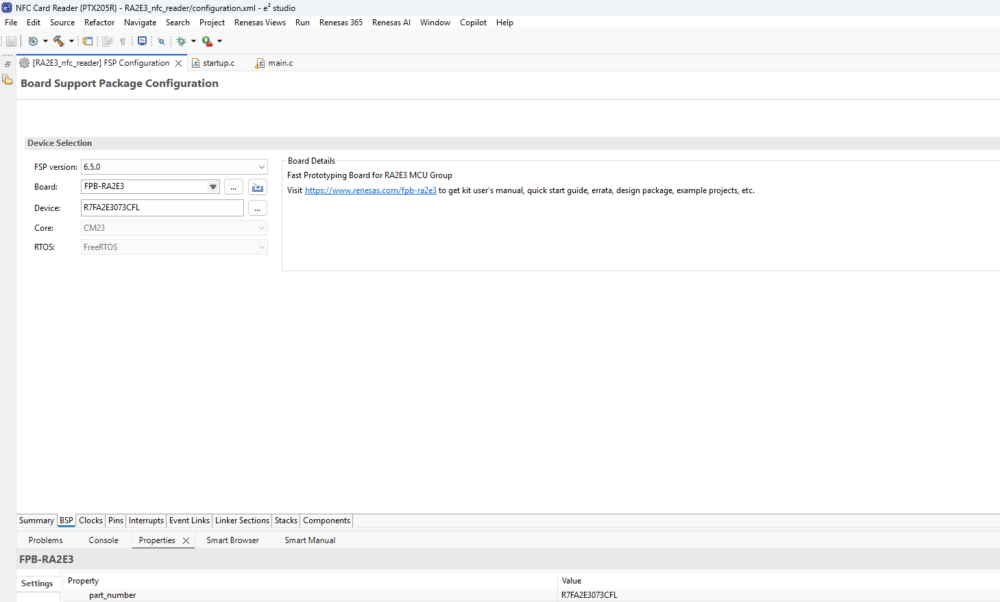

# NFC IoT Card Reader — FPB-RA2E3 + PTX205RIOTEB Evaluation Board

**Renesas Electronics — Confidential** · Rev 2.0 (PTX205R port) · October 2026

| Item | Value |
|---|---|
| MCU | R7FA2E3073CFL (RA2E3, Cortex-M23, 48 MHz) |
| NFC IC | PTX205R (ISO 14443-A/B, NFC-F, ISO 15693) |
| FSP | v6.5.0 + FreeRTOS |
| NFC SDK | PTX2xx SDK (RUL), vendored in [`ptx_sdk/`](ptx_sdk/) — no FSP module |
| Project | nfc-ptx205r-ra2e3 |

> **PTX205R port status.** The RS module, the hardware layer (`src/ptx205r/`)
> and the example build configuration were ported from the PTX105R release and
> verified on the PTX205RIOTEB (card detection + NDEF read, see 6.1).
> PTX205R board photos are from the Renesas
> [PTX205RIOTEB page](https://www.renesas.com/en/design-resources/boards-kits/ptx205rioteb#overview);
> for the board schematic see the
> [PTX205RIOTEB design files](https://www.renesas.com/en/document/pcs/altium-design-files-ptx205rioteb-reva5?r=25612867).

---

## Table of Contents

1. [Overview](#1-overview)
2. [Key Features](#2-key-features)
3. [Demo Bring-Up](#3-demo-bring-up)
   - [Quick Start](#quick-start)
4. [Dependencies](#4-dependencies)
   - 4.1 [FPB-RA2E3 Fast Prototyping Board](#41-fpb-ra2e3-fast-prototyping-board)
   - 4.2 [PTX205RIOTEB Evaluation Board](#42-ptx205rioteb-evaluation-board)
   - 4.3 [Pin Connections](#43-pin-connections)
   - 4.4 [USB UART](#44-usb-uart-log-output)
   - 4.5 [Software Requirements](#45-software-requirements)
   - 4.6 [First-Time vs-code Setup](#46-first-time-vs-code-environment-setup)
5. [FSP Configuration](#5-fsp-configuration)
   - 5.1 [BSP Settings](#51-bsp-settings)
   - 5.2 [FSP Stack Overview](#52-fsp-stack-overview)
   - 5.3 [SCI0 SPI & ICU IRQ7 Properties](#53-sci0-spi--icu-irq7-properties)
   - 5.4 [Pin Assignments](#54-pin-assignments)
6. [Usage](#6-usage)
   - 6.1 [UART Terminal](#61-uart-terminal)
   - 6.2 [LED Feedback](#62-led-feedback)
7. [Data Flow Architecture](#7-data-flow-architecture)
   - 7.1 [Project Structure](#71-project-structure)
   - 7.2 [Software-Layer Architecture](#72-software-layer-architecture)
   - 7.3 [FreeRTOS Task Map](#73-freertos-task-map)
   - 7.4 [Project Configuration](#74-project-configuration)
   - 7.5 [Project Functions](#75-project-functions)
8. [Callback Behavior](#8-callback-behavior)
   - 8.1 [Runtime Flow](#81-runtime-flow)
   - 8.2 [File-Level Ownership Flow](#82-file-level-ownership-flow)
    - 8.3 [NDEF Read Decision Flow](#83-ndef-read-decision-flow)
   - 8.4 [Stop Path Flow](#84-stop-path-flow)
9. [Configuration Parameters](#9-configuration-parameters)
10. [Error Handling](#10-error-handling)
11. [Limitations](#11-limitations)
12. [Integration Recommended](#12-integration-recommended)
    - 12.1 [Integration Guide](#121-integration-guide)
    - 12.2 [Adapting to Custom Board Wiring](#122-adapting-to-custom-board-wiring)
    - 12.3 [Integration Checklist](#123-integration-checklist)
13. [Example](#13-example)
14. [Troubleshooting](#14-troubleshooting)
15. [Summary](#15-summary)
16. [References & Documentation](#16-references--documentation)

---

## 1. Overview

This project contains the **NFC Card Reader** for the Renesas PTX205R, plus
the complete reference firmware that exercises it. The project owns the whole NFC
workflow — discovery, activation, NDEF read, callback dispatch and deactivation —
and hands the application a single filled-in result struct. `rs_nfc_reader.h` is
its only public header. The project talks to the PTX205R SDK (`ptx_RUL_*`)
**directly**. Unlike the PTX105R, the PTX205R has no FSP middleware module: the
SDK is part of this repository ([`ptx_sdk/`](ptx_sdk/)) and plays the role the
FSP `rm_nfc_reader_ptx_sdk` module played for the PTX105R. Its RA HAL port talks
to plain FSP driver instances (SCI SPI, ICU, GPT).

The reference firmware demonstrates a fully autonomous NFC card reader running on the **Renesas RA2E3** microcontroller (R7FA2E3073CFL, Arm® Cortex®-M23). The **PTX205RIOTEB evaluation board** is wired to the **FPB-RA2E3** PMOD1 connector (SPI on SCI0 + IRQ7 + SEN) and supports all major NFC card types out of the box. It builds identically in **e² studio** and **vs-code**, and doubles as the integration reference: FSP stack configuration, pin assignment, the integrator-supplied board symbols, and the `console_io` UART console over SCI9.

The application is built on **Renesas FSP v6.5.0** with **FreeRTOS** and uses a layered software architecture:  
**APP** (Application) → **Project** → **PTX205R SDK** (`ptx_sdk/`) → **FSP Drivers**

Once running, the device continuously wait for NFC cards. On each detection it automatically identifies the card type and UID, attempts an NDEF read (supported for T2T, T3T, T4A, T4B, and T5T — see 2. [Key Features](#2-key-features)), fires a callback, and returns to wait for next NFC cards detection — *no code changes needed when switching card types*.

Card detection and NDEF read results are streamed over the debug UART at **230400 baud on SCI9** for observation on a serial terminal. This release is a **read-only reader**: NDEF write/erase is not implemented.

---

## 2. Key Features

At the core of this project is the NFC reader module, which orchestrates the full NFC workflow between the application and the FSP NFC middleware. In the source tree this module uses the `rs_` / `RS_` file and function prefixes (e.g. `rs_nfc_reader.c`, `rs_nfc_reader_Read()`), and its worker task is named `"RS_NFC"`.

Core project responsibilities:

- Start and stop the reader event (`rs_nfc_reader_Read`, `rs_nfc_reader_Stop`)
- Perform discovery, activation, read, callback dispatch, and deactivation
- Decode NDEF records into the result struct for the application (`result->decoded`)
- Keep upper application logic portable while hardware specifics stay in `rs_nfc_ptx205r.c`

Design highlights:

- **Two public APIs** — `rs_nfc_reader_Read()` and `rs_nfc_reader_Stop()`
- **One public header** — `rs_nfc_reader.h`
- **Fully static allocation** — no heap, no `malloc`; static FreeRTOS task, TCB and stack
- **~0 % idle CPU** — the read loop sleeps on the PTX205R IRQ (ICU IRQ7), with a 100 ms safety re-check (`RS_NFC_PTX205R_WAIT_RECHECK_MS`, 0 = IRQ only)
- **NDEF decoded by the project** — records land in `result->decoded`
- **Vendor isolation** — one HAL header, `ptx205r/rs_nfc_ptx205r.h`; swap the
  `ptx205r/` folder to port to another NFC front-end

The application supplies a config struct and a callback; it never touches the PTX
SDK, never walks TLVs, and never parses an NDEF record header.

| NFC Standard | Tag Type | Example Cards |
|---|---|---|
| ISO 14443-A | Type 2 (T2T) | MIFARE Ultralight, NTAG21x |
| ISO 14443-A | Type 4A (T4A) | MIFARE DESFire, ISO-DEP |
| ISO 14443-B | Type 4B (T4B) | ISO 14443-4 Type B cards |
| NFC-F / FeliCa | Type 3 (T3T) | FeliCa Lite, FeliCa Standard |
| ISO 15693 | Type 5 (T5T) | NFC-V tags (ICODE SLIX, etc.) |

---

## 3. Demo Bring-Up

> **Before you start:** the hardware, wiring and software you need are listed in 4. [Dependencies](#4-dependencies). The FSP configuration details in 5. [FSP Configuration](#5-fsp-configuration) are for reference only — the demo builds as shipped.

### Quick Start

On a machine that is already set up (see 4.6 [First-Time vs-code Setup](#46-first-time-vs-code-environment-setup)),
a fresh clone builds like this:

```bash
# 1. Generate the FSP content: ra/, ra_gen/ and ra_cfg/.
#    Run once per clone, and again after editing configuration.xml.
cd examples/fpb-ra2e3
cmake -P cmake/prebuild.cmake

# 2. Build
#    vs-code   - open ra2e3_nfc_reader.code-workspace, pick the LLVM (ATfE) kit,
#                then run the "Configure Project" and "Build Project" tasks
#    e2 studio - import examples/fpb-ra2e3 as an existing project, then Ctrl+B
```

The remainder of this section walks through the same flow in detail, including the
hardware setup and the flash/debug step.

### Step 1: Hardware Setup

1. Keep the FPB-RA2E3 **unpowered** (USB disconnected) while making connections.
2. On the PTX205RIOTEB, select the **SPI** host interface with the interface jumpers (see the [evaluation kit manual](https://www.renesas.com/en/document/mah/ptx205rioteb-evaluation-kit-manual-reva5?r=25612867)).
3. Wire the PTX205RIOTEB SPI, IRQ, SEN and GND signals to the FPB-RA2E3 **PMOD1** pins listed in 4.3 [Pin Connections](#43-pin-connections). Power the PTX205RIOTEB as described in its manual, and make sure the I/O levels are 3.3 V.
4. Connect a micro-USB cable to **J10** of the FPB-RA2E3. The board powers on and the on-board J-Link OB enumerates both the debug probe and the virtual COM port used for the log output.

### Step 2: Add Project to IDE

> **Note:** Use step **2.A** for **e² studio** and step **2.B** for **vs-code**

### Step 2.A: Import the Project into e² studio

1. Launch **e² studio** and select or create a workspace. The path must **not contain spaces**.  
   `C:\workSpace` ← Good &nbsp;&nbsp; `C:\work Space` ← Bad
2. **File → Import → General → Existing Projects into Workspace → Next**.
3. Click **Browse** → navigate to the `examples/fpb-ra2e3` folder of this repository. The wizard detects **RA2E3_nfc_reader** automatically. Click **Finish**.
4. The project ships with a single build configuration, **Debug**, which is active by default. Confirm it with right-click the project → **Build Configurations → Set Active → Debug**.

### Step 2.B: Open Project into vs-code

1. Launch **vs-code** and **File → Open Workspace from File**.
2. Navigate to `examples/fpb-ra2e3` and select `ra2e3_nfc_reader.code-workspace`.
3. On the popup window, select **ARM LLVM (ATfE) Ninja LLVM-embedded-toolchain-for-Arm (clang) with Ninja**.
4. The default build configuration is **Debug**, and this is the one you need.

### Step 3: Review FSP Configuration

Double-click `configuration.xml` to open the RA Configuration view. Verify BSP tab (device R7FA2E3073CFL, FSP 6.5.0), Stacks tab (SCI SPI, ICU, two GPT and UART instances used by the PTX205R SDK), and Pins tab (SCI0 + IRQ7 assignments). Full details are in 5. [FSP Configuration](#5-fsp-configuration).

### Step 4: Build

> **Note:** Use step **4.A** for **e² studio** and step **4.B** for **vs-code**

### Step 4.A: Build e² studio
1. Confirm the active build configuration is **Debug**.
2. Press **Ctrl+B** or right-click the project → **Build Project**.
3. A successful build prints zero errors:

```
**** Incremental Build of configuration Debug for project RA2E3_nfc_reader ****
make -r --output-sync -j14 all
llvm-size --format=berkeley "RA2E3_nfc_reader.elf"
   text    data     bss     dec     hex filename
  62622     648   12184   75454   126be RA2E3_nfc_reader.elf

Build Finished. 0 errors, 0 warnings.
```

Flash use is `text + data` (≈ 63.3 KB of the RA2E3's 64 KB, including the ~25 KB
PTX205R firmware image); RAM use is `data + bss` (≈ 12.8 KB of 16 KB).

Output files are written to `Debug/`: `RA2E3_nfc_reader.elf` · `.map`

### Step 4.B: Build vs-code
1. Press the Build icon on the bottom bar, or the Build button in the **CMake** tool on the right panel.
2. A successful build prints zero errors:

```
 [build] [89/89 100% :: 26.089] Linking C executable ra2e3_ptx_Iot_fsp_reader.elf
 [driver] Build completed: 00:00:26.473
 [build] Build finished with exit code 0
```

Output files are written to `build/Debug/`: `ra2e3_ptx_Iot_fsp_reader.elf` · `.hex` · `.map` · `.sbd` (the debug bundle consumed by the Renesas debugger)

### Step 5: Flash & Run

> **Note:** Use step **5.A** for **e² studio** and step **5.B** for **vs-code**

### Step 5.A: Flash & Run e² studio


*Figure 1a — Debug Config*

1. Confirm the micro-USB cable is connected to J10 and the board is powered.
2. **Run → Debug Configurations...** → double-click **Renesas GDB Hardware Debugging → RA2E3_nfc_reader Debug_Flat**.
3. If configuring manually, verify the Debugger tab: **J-Link (Renesas)**, target **R7FA2E307**, interface **SWD at 4 MHz**.
4. Click **Debug**. e² studio downloads the `.elf` to the RA2E3 via J-Link and halts at `main()`.
5. Press **Resume (F8)** to start execution.

Call chain:
```
main()                          ← FSP generated
└─ new_thread0_entry()          ← calls app_nfc_reader_entry()
   └─ app_nfc_reader_init()
      └─ rs_nfc_reader_Read()    ← spawns "RS_NFC" worker task
         └─ RS_NFC task              ← NFC event loop runs forever
```

> **Note:** You may need to press **Resume** twice — once past a reset handler breakpoint, once to start `main()`. If the session hangs, press SW1 (RESET) on the FPB-RA2E3 then Resume again.

### Step 5.B: Flash & Run vs-code


*Figure 1b — Debug Config*

1. Confirm the micro-USB cable is connected to J10 and the board is powered.
2. Press **Ctrl+Shift+D** to open **Run and Debug**, then configure the **launch.json** file.
3. Set the following:
   1) For **"executable"** Set ELF file path
   2) For **"gdbTarget"** set remote IP:GDB port
   3) For **"gdbPath"** Set GDB path
   4) For **"device"** Set target device ("R7FA2E307")
   5) For **"-target-select extended-remote localhost:2331"** Set remote IP:GDB port
4. Click the **Start Debugging** icon; vs-code downloads the `.elf` to the RA2E3 via J-Link and halts at `main()`.
5. Use the debug icons to debug.

Call chain:
```
main()                          ← FSP generated
└─ new_thread0_entry()          ← calls app_nfc_reader_entry()
   └─ app_nfc_reader_init()
      └─ rs_nfc_reader_Read()    ← spawns "RS_NFC" worker task
         └─ RS_NFC task              ← NFC event loop runs forever
```


> **Note:** For integration into your own project or customer hardware, check 12. [Integration Recommended](#12-integration-recommended) for the required differences (BSP device selection, pin/channel remap, and stack configuration updates). This Section flow is for running the packaged demo on the reference hardware.

---

## 4. Dependencies

### 4.1 FPB-RA2E3 Fast Prototyping Board


| Resource | Detail |
|---|---|
| MCU | R7FA2E3073CFL — Arm Cortex-M23, 48 MHz HOCO |
| Flash / RAM | 64 KB Flash / 16 KB RAM (FreeRTOS overhead ~10 KB) |
| PMOD1 | SPI via SCI0 (P100/P101/P102/P103) + IRQ7 (P015) |
| Debug UART | SCI9 on P109 (TXD) / P110 (RXD) — 230400 8N1 |
| Debug interface | J10 Micro-USB → on-board J-Link OB (SWD) |
| LEDs | LED1 (P213) and LED2 (P914 / `PMOD1_GPIO9`) — both driven high together for the duration of each card transaction, then low. (P913 is `PMOD1_GPIO10` and P915 is `PMOD1_RESET`; neither is used as an LED by the current firmware.) |
| User button | SW1 (P200 / NMI) |

### 4.2 PTX205RIOTEB Evaluation Board



*Figure 3a — PTX205RIOTEB Evaluation Board, Rev.A5 — top (image: Renesas)*



*Figure 3b — PTX205RIOTEB Evaluation Board, Rev.A5 — bottom (image: Renesas)*

| Feature | Detail |
|---|---|
| Board | PTX205RIOTEB — PTX205R NFC Reader Evaluation Board for IoT Applications, Rev.A5 |
| NFC IC | PTX205R |
| RF Protocols | ISO 14443-A/B, NFC-F (FeliCa), ISO 15693 |
| Antenna | On-board 36 × 36 mm loop |
| Host interface | SPI, I²C or UART, selected with jumpers on the board — **this project uses SPI** |
| SPI (as used here) | 1 MHz, CPHA=0, CPOL=0 (SPI Mode 0), active-low CS |
| IRQ | Active-high, rising edge → P015 / ICU IRQ7 on the FPB-RA2E3 |
| Documentation | [Evaluation kit manual](https://www.renesas.com/en/document/mah/ptx205rioteb-evaluation-kit-manual-reva5?r=25612867) · [Design files (Altium, Rev.A5)](https://www.renesas.com/en/document/pcs/altium-design-files-ptx205rioteb-reva5?r=25612867) · [PTX205R datasheet](https://www.renesas.com/en/document/dst/ptx205r-datasheet) |

### 4.3 Pin Connections

The board schematic is part of the
[PTX205RIOTEB design files](https://www.renesas.com/en/document/pcs/altium-design-files-ptx205rioteb-reva5?r=25612867);
the jumper settings for the SPI host interface and the board-side header pinout
are in the
[PTX205RIOTEB evaluation kit manual](https://www.renesas.com/en/document/mah/ptx205rioteb-evaluation-kit-manual-reva5?r=25612867).
The table below lists the FPB-RA2E3 side, as used by the PTX205R SDK RA port
(`ptx_sdk/SRC/COMPS/HAL/DRV/MCU/RA4M2`).

| PMOD1 Pin | Signal | FPB-RA2E3 Pin | SCI0 Function | Description |
|---|---|---|---|---|
| 1 | MISO | P100 | SCI0 RXD0 | Data from PTX205R to RA2E3 |
| 2 | MOSI | P101 | SCI0 TXD0 | Data from RA2E3 to PTX205R |
| 3 | SCK | P102 | SCI0 SCK0 | SPI clock (1 MHz, Master) |
| 4 | SS / CS | P103 | GPIO output | Chip select (active-low, software-driven GPIO, idle high) |
| 5 | GND | GND | — | Ground |
| 6 | 3V3 | 3.3 V | — | Power supply to PTX205R |
| 7 | IRQ | P015 | ICU IRQ7 | Active-high interrupt from PTX205R |
| 8 | SEN / RESET | P915 | GPIO (`PMOD1_RESET`) | PTX205R SEN (reset) line — output high at boot, driven by the PTX205R SDK HAL |

### 4.4 USB UART (Log Output)

Debug log output is available through the board's USB UART connection. Connect the FPB-RA2E3 to your PC with the USB cable on J10, then open the enumerated COM port in your serial terminal.

> **Note:** The project itself has no UART dependency and can run completely headless. UART is only required by the demo application, for log output.

### 4.5 Software Requirements

| Software | Version / Notes |
|---|---|
| Renesas e² studio | 2025-01 or later |
| Renesas FSP | v6.5.0 |
| LLVM (ATfE) Arm toolchain | 21.1.1 — recorded by RASC as `LLVMARM` (see `cmake/GeneratedCfg.cmake`) |
| PTX205R SDK | PTX2xx SDK (RUL API), vendored in `ptx_sdk/` |
| FreeRTOS | via FSP (rm_freertos_port + Heap 4) |
| Serial terminal | Tera Term, PuTTY or any console app — 230400 8N1 |

For detailed steps on using e² studio, refer to the Renesas e² studio User Guide:
[e² studio | Renesas](https://www.renesas.com/en/software-tool/e2-studio?srsltid=AfmBOorTMc82ySC1OUrEN8SZbrQK2qXPYpFT_VatUYLmZMBeViM4bFTS)

The PTX205R SDK has no FSP module. It is vendored in this repository under
[`ptx_sdk/`](ptx_sdk/) (complete SDK as delivered, including its examples) — no
separate SDK download is required. The example compiles only the reader parts of
it:

| SDK part | Built | Purpose |
|---|---|---|
| `API/RUL` | yes | Main reader API (`ptx_RUL_*`): init, discovery, card registry, select, exchange |
| `API/NATIVE_TAG/T2T..T5T`, `API/NDEF/TAG_TYPES/NDEF_T2T..T5T` | yes | Per-tag-type NDEF read (T3T/T4T/T5T used; T2T NDEF is hand-rolled in `rs_ndef_read.c`) |
| `COMPS/HAL` + `COMPS/HAL/DRV/MCU/RA4M2` | yes | Host interface (SPI), GPIO, timers. The `RA4M2` folder holds the RA port adapted to the FPB-RA2E3 |
| `COMPS/HIP`, `COMPS/NSC` (+ `RUL`, `UCODE`), `COMPS/LOG/NONE`, `COMPS/UTILS` | yes | PTX205R protocol stack, firmware image (~25 KB), no-op logging |
| everything else (examples, HCE/listen mode, WLC, LLCP/SNEP, EMV/FeliCa DTE, I2C/UART host interfaces, other platforms) | no | Excluded in `CMakeLists.txt` and `.cproject` |

The SDK build options are compile definitions (both build systems):
`PTX_PLATFORM_MCU`, `PTX_ENABLE_SPI`, `PTX_APP_DIVERSITY_RA4M2`, `PTX_LOG_DISABLED`,
`PTX_DEBUG_PRINTS_DISABLE`, `PTX_DISABLE_COMP_CHECK`, `PTX_DISABLE_WLC`,
`PTX_DISABLE_LISTEN_MODE`, `PTX_DISABLE_LISTEN_B`. Add `PTX_DISABLE_NDEF_T3T` /
`PTX_DISABLE_NDEF_T5T` to compile out the T3T / T5T NDEF reader (cards are still
detected and their UID reported).

> **Flash budget:** the image only fits the RA2E3's 64 KB flash with link-time
> optimization — `-flto` (compiler and linker) and `-Wl,-mllvm,-enable-machine-outliner`
> are set in `CMakeLists.txt` and `.cproject`. Without them the link overflows
> by ~7 KB.

### 4.6 First-Time vs-code Environment Setup

Before generating, building, or debugging in vs-code, install the tools below and
point a handful of environment variables at them **once per machine**. The
vs-code and CMake configuration reads those variables to locate each toolchain,
so any installed version works — nothing is hard-coded to a specific release.

#### Install these first

Make sure the following are available on the machine:

| Tool | How to get it | Required? |
|---|---|---|
| vs-code | [Visual Studio Code](https://code.visualstudio.com) | Yes (code editor) |
| LLVM (ATfE) Arm toolchain | Installed with **e² studio** (Help ▸ Add Renesas Toolchains), or download from [arm/arm-toolchain releases](https://github.com/arm/arm-toolchain/releases) (assets named `ATfE-*`) | Yes (compile) |
| RA Smart Configurator (RASC) | [Renesas RA Smart Configurator](https://www.renesas.com/en/software-tool/ra-smart-configurator) | Yes (regenerate) |
| **CMake** (bundles **Ninja**) | [cmake.org/download](https://cmake.org/download/) or `winget install Kitware.CMake` | Yes (build) |
| Arm GNU toolchain (`arm-none-eabi-gdb`) | [Arm GNU Toolchain downloads](https://developer.arm.com/downloads/-/arm-gnu-toolchain-downloads) or `winget install Arm.ArmGnuToolchain` | Only for hardware debug |

> The LLVM (ATfE) toolchain and RASC are installed by the Renesas installers.
> **CMake**, **Ninja**, and the **Arm GNU debugger** are *not* — install them
> separately if they are not already present.

#### Set these environment variables

| Variable | Point it at | Used for |
|---|---|---|
| `ARM_TOOLCHAIN_PATH` | LLVM (ATfE) `bin` folder | Compiling the project (**required**) |
| `CMAKE_PATH` | the `cmake` executable | Configuring & building (**required**) |
| `NINJA_PATH` | Ninja `bin` folder | Building |
| `ARM_GDB_PATH` | the `arm-none-eabi-gdb` executable | Hardware debugging (optional) |
| `RASC_EXE_PATH` | the RASC `rasc.exe` | Regenerating FSP files (optional) |

`ARM_TOOLCHAIN_PATH` is also honoured under the toolchain-specific aliases
`ARM_LLVM_TOOLCHAIN_PATH` and `ARM_GCC_TOOLCHAIN_PATH`, so both compilers can be
registered side by side. `RASC_EXE_PATH` is optional: `Config.cmake` falls back to
searching the standard install locations (`C:/Renesas/RA/sc_v*/eclipse/rasc.exe`
and `%LOCALAPPDATA%/Programs/Renesas/RA/sc_v*`) and picks the newest it finds.

**Windows** — set them as *user* environment variables (no admin rights needed),
either through **Settings ▸ System ▸ About ▸ Advanced system settings ▸
Environment Variables**, or from a terminal with `setx`:

```bat
setx ARM_TOOLCHAIN_PATH "C:\Path\To\ATfE\bin"
setx CMAKE_PATH        "C:\Program Files\CMake\bin\cmake.exe"
setx NINJA_PATH        "C:\Program Files\CMake\bin"
setx ARM_GDB_PATH      "C:\Path\To\ArmGNUToolchain\bin\arm-none-eabi-gdb.exe"
setx RASC_EXE_PATH     "C:\Renesas\RA\sc_v2025-12_fsp_v6.5.0\eclipse\rasc.exe"
```

> `setx` only affects **new** processes — the terminal you typed it in keeps the
> old values.

**Linux / macOS** — add the exports to your shell profile (`~/.profile` or
`~/.bashrc`), then `source` it or log out and back in:

```bash
export ARM_TOOLCHAIN_PATH="$HOME/toolchains/ATfE/bin"
export CMAKE_PATH="/usr/bin/cmake"
export NINJA_PATH="/usr/bin"
export ARM_GDB_PATH="/usr/bin/arm-none-eabi-gdb"
```

Install any missing tools with your package manager, e.g.
`sudo apt install cmake ninja-build gdb-arm-none-eabi`.

> **IMPORTANT:** After setting the variables, **close and re-open vs-code** so it
> picks up the new environment.

---

## 5. FSP Configuration

FSP configuration can be done with **e² studio**, **Renesas Smart Configuration (RASC)**, or **vs-code with Renesas Extension**. The configuration itself will produce the same function regardless of the tool used. Refer to the documentation for your chosen tool:

- **e² studio**: [e² studio Integrated Development Environment User's Manual: Quick Start Guide](https://www.renesas.com/en/document/qsg/renesas-ra-family-e2-studio-2023-10-or-higher-quick-start-guide?r=488826) — See **CHAPTER 3: PROJECT GENERATION**
- **vs-code Extension**: [Renesas vs-code Extensions User Guide](https://tool-support.renesas.com/e2studio/vscode/docs/) — See **Section 3: Creating and Building a Project**
   - **Renesas Smart Configurator (RASC)**: [RA Smart Configurator | Renesas](https://tool-support.renesas.com/e2studio/vscode/docs/creating-and-building-project.html#using-renesas-ra) - See **Additional Details**

### 5.1 BSP Settings

| Setting | Value |
|---|---|
| FSP Version | 6.5.0 |
| Board | FPB-RA2E3 (board.ra2e3_fpb) |
| Device | R7FA2E3073CFL · LQFP48 · Cortex-M23 |
| RTOS | FreeRTOS (rm_freertos_port) |
| ROM / RAM | ~64 KB / ~16 KB |
| Main stack | 1,024 bytes |
| Heap | 256 bytes (FreeRTOS manages its own 2 KB heap) |
| MCU Vcc | 3,300 mV |
| Toolchain | LLVM (ATfE) 21.1.1 — RASC toolchain id `LLVMARM` |

### 5.2 FSP Stack Overview



*Figure 5 — FSP Stacks tab: HAL/Common stacks (UART, SCI SPI, ICU IRQ7, two GPT timers, FreeRTOS)*

There is no NFC middleware module in the FSP configuration. The PTX205R SDK's RA
HAL port binds to the following driver instances **by name** (see
`src/ptx205r/rs_nfc_ptx205r_board.h`), so these names must not be changed:

| FSP Module | Instance | Role |
|---|---|---|
| `r_sci_spi` | `ptx_pmod2_spi` | SCI0 SPI Master — CPHA=0, CPOL=0, MSB-first, no callback, no DTC. FSP bitrate 500 kHz; the SDK HAL sets 1 MHz when it opens the interface |
| `r_icu` | `ptx_pmod2_irq` | ICU IRQ7 on P015 — rising edge. Opened by the SDK; the RS module installs its own callback while waiting for a card |
| `r_gpt` | `ptx_tmr0` | GPT Ch4 — SDK timer 0 (timeouts) |
| `r_gpt` | `ptx_tmr1` | GPT Ch0 — SDK timer 1 (sleeps) |
| `r_sci_uart` | `g_uart_jlob_vcom` | SCI9 — 230400 8N1 UART on P109 (TX) / P110 (RX), used by `console_io` |
| `r_ioport` | `g_ioport` | GPIO — LEDs, SPI CS (P103), PTX205R SEN (P915) |
| `rm_freertos_port` + Heap 4 | — | FreeRTOS |

### 5.3 SCI0 SPI & ICU IRQ7 Properties

**SCI0 SPI (ptx_pmod2_spi)**

| Property | Value |
|---|---|
| Channel | SCI0 |
| Mode | Master |
| CPHA | 0 (leading edge) |
| CPOL | 0 (clock idle low) |
| Bit Order | MSB First |
| Bitrate | 500,000 bps in FSP; 1,000,000 bps set by the SDK HAL at open |

**ICU IRQ7 (ptx_pmod2_irq)**

| Property | Value |
|---|---|
| Channel | 7 (P015) |
| Trigger | Rising Edge |
| Priority | 2 |

> **Note:** Move to another ICU IRQ if PTX IRQ is rerouted to a different external IRQ-capable pin, then FSP pin + ICU configuration is updated and code is regenerated (for example, vectors/common_data will change accordingly). For the rest of this document, we use **ICU IRQ7**.

### 5.4 Pin Assignments



*Figure 6 — Pins tab: active pin configuration `R7FA2E3073CFL.pincfg` (generated as `g_bsp_pin_cfg`), Interrupt:ICU → IRQ7 = P015*

The active pin configuration is **`R7FA2E3073CFL.pincfg`** with **Generate data: `g_bsp_pin_cfg`**
(Figure 6). The peripherals in use are Connectivity:SCI (SCI0 SPI, SCI9 UART),
Debug:JTAG/SWD, Interrupt:ICU and System:SYSTEM. Under **Interrupt:ICU**, only
**IRQ7** is assigned, to **P015**. This pin must stay in IRQ mode: the PTX205R
SDK reads its level, and the RS module sleeps on its interrupt.

| Peripheral | Pin | Symbolic Name | Function |
|---|---|---|---|
| SCI0 RXD0 | P100 | `ARDUINO_D12_MISO_PMOD1_MISO` | SPI MISO ← PTX205R |
| SCI0 TXD0 | P101 | `ARDUINO_D11_MOSI_PMOD1_MOSI` | SPI MOSI → PTX205R |
| SCI0 SCK0 | P102 | `ARDUINO_D13_SCK_PMOD1_SCK` | SPI Clock |
| GPIO output | P103 | `ARDUINO_D10_SS_PMOD1_SS` | SPI CS (active-low, software GPIO) |
| ICU IRQ7 | P015 | `PMOD1_IRQ7` | PTX205R interrupt |
| SCI9 TXD9 | P109 | `ARDUINO_D1_TX` | UART TX → PC (log output) |
| SCI9 RXD9 | P110 | `ARDUINO_D0_RX` | UART RX ← PC (reserved) |
| GPIO output | P915 | `PMOD1_RESET` | PTX205R SEN (reset) line — output high at boot, driven by the SDK HAL |
| GPIO output | P213 | `LED1` | Card-event LED (output low at boot) |
| GPIO output | P914 | `LED2_PMOD1_GPIO9` | Card-event LED (output low at boot) |

---

## 6. Usage

### 6.1 UART Terminal

1. Open your serial terminal (Tera Term, PuTTY or any console app) at **230400 baud, 8N1**.


2. On startup the application prints:


```
System Initialization (RS NFC Reader) ... starting
RS NFC Reader launched (non-blocking)
```

3. Place an NFC card close to the PTX205RIOTEB antenna. Output captured on the PTX205RIOTEB for a Type 4A tag holding one NDEF Text record:

```
CARD DETECTED! type=NFC-T4A UID=02840017810196 NDEF=23B

RF Technology  : TYPE A
Tag Type       : ISO-DEP (Type 4 Tag / ISO 14443-4)
Serial Number  : 02:84:00:17:81:01:96
Size           : 8192 bytes
Writeable      : Yes
NDEF           : 23 bytes

NDEF raw (23 bytes): D1 01 13 54 02 65 6E 35 35 35 35 35 35 35 35 35
                        35 35 35 35 35 35 35
Records        : 1
[0] TNF=0x01 (NFC Forum well-known) Type='T'  Payload=19 bytes
        Text : "5555555555555555"
```

The UID, size and NDEF content depend on the card used.

### 6.2 LED Feedback

On every card transaction the firmware drives **LED1 (P213)** and **LED2 (P914 / `PMOD1_GPIO9`)** HIGH together at the start of the card event, then LOW once the card has been processed. There is **no per-card-type LED coding and no timed blink** — the two LEDs simply act as a single "card active" indicator.

| Event | LED Action |
|---|---|
| Card detected / being processed | LED1 + LED2 driven HIGH |
| Field clear / processing done | LED1 + LED2 driven LOW |

> **Note:** LED feedback is compiled in via `APP_NFC_READER_LED_EN` in `app_nfc_reader.h`; comment out that macro to disable LED code entirely.

---

## 7. Data Flow Architecture

### 7.1 Project Structure

The NFC reader project is the product of this repository and lives at the top
level, so it can be consumed without dragging an example along. The FPB-RA2E3
firmware is one consumer of it, under `examples/fpb-ra2e3/`.

```
rs-nfc-card-reader/
│
├── README.md                              ← this document
├── readme_assets/                         ← figures referenced by this document
│
├── src/                                   ← Project module: public header + NFC protocol orchestration
│   ├── rs_nfc_reader.h                    ← Project public API header (single include)
│   ├── rs_nfc_reader.c                    ← Project reader + "RS_NFC" task (detect, retry, dependency check, card summary)
│   ├── rs_ndef_read.c                     ← NDEF read (T2T page/TLV; T3T/T4T/T5T via PTX SDK) + record decode
│   └── ptx205r/
│       ├── rs_nfc_ptx205r.c               ← PTX205R HAL → direct ptx_RUL_* calls
│       ├── rs_nfc_ptx205r.h               ← vendor HAL contract — the porting seam
│       └── rs_nfc_ptx205r_board.h         ← integrator-supplied board symbols (ptx_pmod2_irq) + discovery tuning
│
├── ptx_sdk/                              ← PTX205R SDK (PTX2xx RUL stack) — replaces the PTX105R FSP SDK module
│   └── SRC/                               ← API/ (RUL, NDEF, NATIVE_TAG, …), COMPS/ (HAL + RA port, HIP, NSC + firmware, …), EXAMPLES/
│
├── test/                                  ← Unit-test placeholders + PTX205R mock (root only, never copied into the example)
│   ├── test_nfc_reader.c
│   ├── test_ndef_read.c
│   └── mocks/mock_ptx205r_adapter.c
│
└── examples/
    └── fpb-ra2e3/                         ← Reference firmware (this document)
        ├── src/
        │   ├── hal_entry.c                ← FSP HAL entry hook
        │   ├── new_thread0_entry.c        ← FreeRTOS task entry → app_nfc_reader_entry()
        │   ├── app/                       ← APP Layer: Application + LED + log
        │   │   ├── app_nfc_reader.c/.h    ← App entry, card-event callback, LED helpers
        │   │   └── app_nfc_reader_log.c/.h← UART log + card-info print
        │   ├── console_io/                ← minimal printf over SCI9 UART (no libc stdio)
        │   │   └── console_io.c/.h
        │   └── rs_nfc_card_reader/       ← committed copy of the project above (see note)
        │       ├── rs_nfc_reader.h        ← Project public API header
        │       ├── rs_nfc_reader.c        ← orchestrator + "RS_NFC" task
        │       ├── rs_ndef_read.c         ← NDEF read + record decode
        │       └── ptx205r/               ← PTX205R backend (.c/.h + board header)
        ├── ra/                            ← [generated] FSP + CMSIS + FreeRTOS sources
        ├── ra_gen/                        ← [generated] FSP project content (do not edit)
        ├── ra_cfg/                        ← [generated] FSP configuration headers (do not edit)
        │   └── fsp_cfg/
        ├── cmake/
        │   ├── gcc.cmake                  ← GCC ARM Embedded toolchain file
        │   ├── llvm.cmake                 ← LLVM (ATfE) toolchain file
        │   ├── GeneratedCfg.cmake         ← [RASC-generated] compiler/linker flags, device info
        │   ├── GeneratedSrc.cmake         ← [RASC-generated] source globs, include paths, targets
        │   ├── prebuild.cmake             ← headless RASC generation + configuration.xml repair
        │   └── make_sbd.cmake             ← builds the .sbd debug bundle
        ├── script/
        │   └── fsp.lld                    ← Linker script
        ├── .vscode/                       ← tasks, launch, CMake kits, C/C++ and editor settings
        ├── .project / .cproject / .settings/  ← e² studio project metadata
        ├── CMakeLists.txt                 ← build root (pulls in the two Generated*.cmake files)
        ├── Config.cmake                   ← locates the RASC executable
        ├── ra2e3_nfc_reader.code-workspace← vs-code workspace (window-scoped settings)
        ├── configuration.xml              ← FSP stack + pin config (open in e² studio / RASC)
        ├── Debug_Flat.launch              ← Pre-configured J-Link debug launch
        ├── readme_assets/                 ← figures referenced by this document
        └── README.md                      ← this document
```

> **Note:** `README.md` and `readme_assets/` deliberately exist twice — once at
> the repository root and once in the example. The two README copies are kept
> **identical**, so the document reads the same whether you arrive at the
> repository root or at the example, and every figure link resolves from either
> location. Edit one, then copy it over the other.

#### Repository Organization

| Area | Purpose |
|---|---|
| `src/` | The single public header, the project implementation, and the vendor HAL backend |
| `test/` | Host-side unit-test placeholders and mocks |
| `examples/` | Complete reference projects for hardware validation |

The project is the product; the example is one consumer of it. The example vendors
its own copy of the library at `examples/fpb-ra2e3/src/rs_nfc_card_reader/`,
committed alongside the rest of the example so that a plain checkout builds in
both e² studio and vs-code with no pre-build step for the project sources. The copy
is deliberate duplication: the library at `src/` remains the source of truth, and
the example's copy has to be refreshed by hand when it changes.

Typical development workflow:

```text
Set up environment (once)
        ↓
Generate FSP content (RASC)
        ↓
Modify project source
        ↓
Build firmware
        ↓
Validate on hardware
        ↓
Commit changes
```

> **Note:** `examples/fpb-ra2e3/src/rs_nfc_card_reader/` is a **committed
> copy** of the library at the repository root — ordinary source files, not
> links and not generated at build time. Both e² studio and vs-code compile it
> straight from the checkout, with no pre-build step. The unit tests are not
> copied into the example; they live only at the repository root under
> `test/`, so nothing under `src/` has to be excluded from the firmware. The
> repository root stays the source of truth, so this copy must be refreshed by
> hand when the library changes.

> **Note:** Never manually edit files in `ra_gen/` or `ra_cfg/`. These are regenerated by the FSP tooling whenever `configuration.xml` is saved. They do not exist in a fresh clone — run `cmake -P cmake/prebuild.cmake` from `examples/fpb-ra2e3` once to generate `ra/`, `ra_gen/` and `ra_cfg/` before the first build.

### 7.2 Software-Layer Architecture

Use this mental model: each layer has one clear responsibility and only calls the layer directly below it.

| Layer | Main responsibility | Key files |
|---|---|---|
| Application (APP) | Product behavior (logs, LED, when to read) | `src/app/app_nfc_reader.c`, `src/new_thread0_entry.c` |
| Project module | NFC state machine (discover, activate, read, callback, deactivate, loop) | `src/rs_nfc_card_reader/rs_nfc_reader.c`, `rs_ndef_read.c` |
| PTX205R adapter | Converts project module calls to PTX SDK operations | `src/rs_nfc_card_reader/ptx205r/rs_nfc_ptx205r.c`, `rs_nfc_ptx205r.h` |
| PTX SDK + FSP drivers | NFC protocol ops and MCU peripheral access | `ptx_RUL_*` (`ptx_sdk/`), `R_SCI_SPI`, `R_ICU`, `R_GPT` |
| Hardware | Physical RF + MCU execution platform | RA2E3 board + PTX205R PMOD |

**Important boundary**

The PTX adapter (`rs_nfc_ptx205r.c`) calls the PTX205R SDK (`ptx_RUL_*`, `ptx_sdk/`) directly. There is no FSP NFC middleware layer for the PTX205R.

**Call flow (top-down)**



**One runtime cycle (reader mode)**

1. APP starts reader by calling `rs_nfc_reader_Read()`.
2. The project task performs discovery and waits for card activation.
3. The project calls the PTX adapter for activate + data exchange.
4. NDEF is parsed/read.
5. APP callback receives UID/card/NDEF info.
6. The project deactivates card and returns to discovery loop.

This split keeps APP logic independent from PTX hardware details, so APP + project layers are reusable while only the PTX adapter is board/reader specific.

### 7.3 FreeRTOS Task Map

FreeRTOS is required for the non-blocking project mode, because `rs_nfc_reader_Read()` creates and runs the asynchronous `RS_NFC` worker task.

| Task | Created by | Stack | Priority | Role |
|---|---|---|---|---|
| `new_thread0` | FSP (static) | 1 KB (1024 B) | 1 | Calls app_nfc_reader_entry() then suspends |
| `RS_NFC` | rs_nfc_reader_Read() | ~4 KB (static) | 1 | Runs full NFC event-loop. Self-deletes when stopped. |
| `IDLE` | FreeRTOS kernel | 512 B | 0 | FreeRTOS idle task |

**Per-task notes**

- `new_thread0`: Startup task created by FSP. After initialization it suspends, so its stack remains reserved but mostly idle during normal operation.
- `RS_NFC`: Main worker task for discovery/activation/read/deactivation and callback dispatch. This stack is sized larger because protocol handling and card I/O paths are deeper than startup or idle paths.
- `IDLE`: Mandatory kernel task that runs when no other ready task exists. It provides background kernel housekeeping and must always have enough stack for the port's idle-path hooks.

The stack column is reserved RAM per task, so these three tasks consume about 5.5 KB of fixed stack budget in total. In practice, add a small extra margin for each task's TCB/control data and keep some free headroom to avoid stack overflow under peak paths.

> **Note:** All task stacks are **statically allocated**. `configSUPPORT_STATIC_ALLOCATION` must be `1` in `FreeRTOSConfig.h`. The FreeRTOS heap (2 KB) is reserved for the kernel only.

### 7.4 Project Configuration

The NFC reader module is the main NFC coordination layer in this project. The APP layer configures it once, then it handles discovery, activation, read/callback dispatch, and clean shutdown. All available functions are listed in ** 7.5 [Project Functions](#75-project-functions)** below.

#### Configuration Struct

`rs_nfc_reader_cfg_t` is the main input to the project module. The application layer fills it in `app_nfc_reader_init()` before calling `rs_nfc_reader_Read()`.

```c
typedef struct st_rs_nfc_reader_cfg {
    rs_nfc_tech_mask_t      tech_mask;
    uint32_t                timeout_ms;
    uint8_t                 retry_count;
    bool                    read_ndef;
    uint16_t                max_ndef_bytes;
    bool                    run_raw_exchange;
    rs_nfc_callback_t       callback;
    void                   *p_context;
    rs_nfc_card_event_cb_t  on_card_event;
    void                   *p_card_event_context;
    bool                    validate_dependencies;
    bool                    cfg_valid_check_en;
} rs_nfc_reader_cfg_t;
```

| Field | Type | Meaning |
|---|---|---|
| `tech_mask` | `rs_nfc_tech_mask_t` | Technologies to poll for. The project uses `RS_NFC_TECH_ALL` (ISO 14443-A/B, NFC-F, ISO 15693, NFC Forum). |
| `timeout_ms` | `uint32_t` | Maximum run time for `rs_nfc_reader_Read()`. `UINT32_MAX` (`RS_NFC_TIMEOUT_INFINITE`) means run forever. |
| `retry_count` | `uint8_t` | Per-operation retry budget. `0` (`RS_NFC_RETRY_DISABLED`) disables retries. |
| `read_ndef` | `bool` | When `true`, the project reads NDEF data for a detected card and fills the result struct. |
| `max_ndef_bytes` | `uint16_t` | Upper bound on the NDEF payload copied into `result->ndef_data`. The project uses `RS_NFC_NDEF_MAX_BYTES`. |
| `run_raw_exchange` | `bool` | When `true`, after activation the project performs a protocol-appropriate raw frame exchange and exposes it via `result->raw_exchange`. No effect for ISO-DEP. |
| `callback` | `rs_nfc_callback_t` | Completion callback for non-blocking `Read()`. If `NULL`, `Read()` uses the blocking flow and no completion callback fires. |
| `p_context` | `void *` | User context passed back to `callback`. May be `NULL`. |
| `on_card_event` | `rs_nfc_card_event_cb_t` | Per-card callback fired each time a card is detected and activated — the important hook for the application. |
| `p_card_event_context` | `void *` | User context passed back to `on_card_event`. |
| `validate_dependencies` | `bool` | When `true`, the project also checks the lower-level PTX205R stack is ready before starting. |
| `cfg_valid_check_en` | `bool` | Gate for `rs_nfc_reader_validate()` inside `Read()`. Because `memset(&cfg,0,...)` zeroes it to `false`, callers must set it to `true` to keep config validation enabled. |

#### Result Struct

`rs_nfc_card_result_t` is the per-card payload handed to the application callback. It is populated by the project read flow, then reused on the next card event, so the application must copy anything it needs after the callback returns.

```c
struct st_rs_nfc_card_result {
    rs_nfc_card_type_t      card_type;
    ptx_RUL_CardProtocolType_t protocol;
    uint8_t                 uid[RS_NFC_UID_MAX_BYTES];
    uint8_t                 uid_len;
    bool                    ndef_present;
    uint8_t                 ndef_data[RS_NFC_NDEF_MAX_BYTES];
    uint16_t                ndef_len;
    rs_ndef_decoded_t       decoded;
    int8_t                  rssi_dbm;
    uint32_t                read_time_ms;

    uint32_t                data_area_size;
    bool                    writeable;
    const char             *tag_type_name;

    rs_nfc_raw_exchange_t   raw_exchange;
};
```

| Field | Type | Meaning |
|---|---|---|
| `card_type` | `rs_nfc_card_type_t` | Normalized card classification such as T2T, T4A, T4B, T3T, or T5T. |
| `protocol` | `ptx_RUL_CardProtocolType_t` | Active RF protocol as reported by the PTX SDK (`ptx_RUL_CardProtocolType_T2T` / `_T3T` / `_T4T` (ISO-DEP) / `_T5T` / …). |
| `uid` | `uint8_t[10]` | Raw UID bytes as read from the card. |
| `uid_len` | `uint8_t` | Number of valid bytes in `uid`. |
| `ndef_present` | `bool` | `true` if the project found an NDEF message on the card. |
| `ndef_data` | `uint8_t[512]` | NDEF payload buffer. |
| `ndef_len` | `uint16_t` | Length of valid data in `ndef_data`. |
| `decoded` | `rs_ndef_decoded_t` | NDEF records parsed from `ndef_data` by `rs_nfc_reader_Read()`. Each record's `payload` points into `ndef_data`, so it is valid only while this result is alive. |
| `rssi_dbm` | `int8_t` | Optional RF signal strength. Some backends leave it `0` if unsupported. |
| `read_time_ms` | `uint32_t` | Time spent reading the current card event. |
| `data_area_size` | `uint32_t` | Card capacity derived from the card's capability data. |
| `writeable` | `bool` | `true` if the detected card reports write access (informational; firmware does not write). |
| `tag_type_name` | `const char *` | Human-readable tag description, e.g. `NFC Forum Type 2 Tag (T2T)`. Static string — do not free. |
| `raw_exchange` | `rs_nfc_raw_exchange_t` | Snapshot of the last raw protocol exchange (valid/status/tx/rx). Populated only when `run_raw_exchange = true`; check `.valid` before use. |

### 7.5 Project Functions

#### Project Functions Reference

| Function | Scope | Purpose | Notes |
|---|---|---|---|
| `rs_nfc_reader_Read()` | Public | Start the NFC flow | Blocking when `callback == NULL`, non-blocking when `callback != NULL`. Loops one event per card when `on_card_event` is set. |
| `rs_nfc_reader_Stop()` | Public | Stop a running read | Wakes the blocked wait and exits cleanly. Returns `RS_OK` always. |

> **Note:** These two functions are the **entire public API**. Card-info reading and NDEF record decoding happen internally during `Read()` — the parsed records are delivered to the application in `result->decoded`, so no separate decode call is exposed.

#### Typical Application Setup

The project currently configures the project from `app_nfc_reader_init()` like this:

```c
rs_nfc_reader_cfg_t cfg;
memset(&cfg, 0, sizeof(cfg));
cfg.tech_mask             = RS_NFC_TECH_ALL;
cfg.timeout_ms            = RS_NFC_TIMEOUT_INFINITE;
cfg.retry_count           = RS_NFC_RETRY_DISABLED;
cfg.read_ndef             = RS_NFC_NDEF_READ_ENABLED;
cfg.max_ndef_bytes        = RS_NFC_NDEF_MAX_BYTES;
cfg.run_raw_exchange      = RS_NFC_RAW_EXCHANGE_ENABLED;
cfg.callback              = on_nfc_operation_done;
cfg.p_context             = RS_NFC_CONTEXT_NONE;
cfg.on_card_event         = on_nfc_read_done;
cfg.p_card_event_context  = RS_NFC_CONTEXT_NONE;
cfg.validate_dependencies = RS_NFC_DEP_VALIDATION_DISABLED;
cfg.cfg_valid_check_en    = RS_NFC_CFG_VALIDATION_ENABLED;

/* Non-blocking: pass NULL for result_out — the RS_NFC worker task uses
 * its own task-local result buffer. Passing the address of a caller-local
 * would dangle once the caller returns. */
(void)rs_nfc_reader_Read(&cfg, NULL);
```

#### What To Keep In Mind

- `on_card_event` is the important project hook for the project. It fires once per detected card.
- `callback` is only for completion of a non-blocking `Read()` call.
- The result struct is reused by the project, so copy any data you need after the callback returns.
- The project reads the card info (capacity, write access, tag name) and decodes the NDEF records into `result->decoded` internally, before firing `on_card_event` — the app just reads the result fields.

---

## 8. Callback Behavior

### 8.1 Runtime Flow



### 8.2 File-Level Ownership Flow

```mermaid
flowchart LR
   subgraph APP[APP Layer]
      A1[new_thread0_entry.c and hal_entry.c]
      A2[app_nfc_reader.c]
      A4[app_nfc_reader_log.c]
   end

   subgraph PRJ[Project Module]
      P1[rs_nfc_reader.c]
      P3[rs_ndef_read.c]
   end

   subgraph PTX[PTX Adapter]
      T1[ptx205r/rs_nfc_ptx205r.c]
      T2[ptx205r/rs_nfc_ptx205r.h]
   end

   subgraph SDK[SDK and Drivers]
      S1[ptx_RUL_* (PTX205R SDK)]
      S2[R_SCI_SPI and R_ICU and R_GPT]
   end

   A1 --> A2
   A2 --> P1
   A4 --> A2

   P1 --> P3
   P1 --> T1
   P1 --> T2
   T1 --> S1
   S1 --> S2
```

### 8.3 NDEF Read Decision Flow



> **Note:** This release only *reads* NDEF. There is no write/erase path — NDEF write is not implemented for any tag type.

### 8.4 Stop Path Flow



---

## 9. Configuration Parameters

Key FSP and firmware configuration options:

| Parameter | File | Default | Purpose |
|---|---|---|---|
| `configMAX_PRIORITIES` | `FreeRTOSConfig.h` | 3 | Task priority levels |
| `configTIMER_TASK_STACK_DEPTH` | `FreeRTOSConfig.h` | 128 | FreeRTOS timer task stack size (words) |
| `RS_NFC_NDEF_MAX_BYTES` | `rs_nfc_reader.h` | 512 | Maximum NDEF message size |
| `UART baud rate` | FSP Configurator (`g_uart_jlob_vcom`) | 230400 | Debug log output speed |
| `SPI clock` | FSP Configurator (`ptx_pmod2_spi`) + SDK HAL | 1 MHz (set by the SDK at open) | PTX205R SPI communication speed |

---

## 10. Error Handling

Common error scenarios and recovery. The project layer reports status via the `rs_status_t`
enum (`rs_nfc_reader.h`):

| Status / Error | Cause | Recovery |
|---|---|---|
| `RS_ERR_TIMEOUT` | Card removed or polling timeout | Retry detection in main loop |
| `RS_ERR_INVALID_CFG` | Malformed `rs_nfc_reader_cfg_t` | Fix config fields; keep `cfg_valid_check_en = true` |
| `RS_ERR_DEPENDENCY` | Lower PTX205R stack not ready | Verify FSP stack + `validate_dependencies` |
| `RS_ERR_NOT_FOUND` | Card not NDEF-formatted | Log and continue polling |
| `RS_ERR_BUFFER_OVERFLOW` | NDEF larger than `max_ndef_bytes` | Increase `max_ndef_bytes` (≤ `RS_NFC_NDEF_MAX_BYTES`) |
| `RS_ERR_INTERNAL` | Second non-blocking `Read()` while one is active, or internal fault | Stop the running read first; reset PTX205R if persistent |

---

## 11. Limitations

* **NDEF write/erase**: Not implemented in this release — the firmware is a **read-only** reader for all tag types (T2T/T3T/T4T/T5T).
* **SPI transport scope**: The PTX205R integration uses SCI-SPI through the SDK RA port (`ptx_sdk/SRC/COMPS/HAL/DRV/MCU/RA4M2`). Dedicated RA SPI peripherals such as `R_SPI` are not supported in this release.
* **Simultaneous card detection**: Only one card can be activated per read cycle. When discovery resolves several cards, the reader reports `WARN: multiple cards detected, reading the first one` (card event with `result == NULL`) and reads the first card.
* **NDEF message size**: Limited by on-tag memory and by `RS_NFC_NDEF_MAX_BYTES` (512 bytes).
* **RA2E3 RAM**: 16 KB total; dynamic allocation is minimal. All task stacks are statically allocated.
* **FreeRTOS heap**: 2 KB reserved for kernel; user malloc limited by remaining RAM.
* **ISO 15693 (NFC-V)**: Basic detection supported; advanced features (AFI, DSFID) not implemented.
* **Flash (RA2E3, 64 KB)**: the e² studio Debug build uses ~63.3 KB (text + data) with LTO, including the ~25 KB PTX205R firmware image; ~2 KB headroom. Use `PTX_DISABLE_NDEF_T3T` / `PTX_DISABLE_NDEF_T5T` to free space.
* **PTX205R SDK stays initialized** between `rs_nfc_reader_Read()` calls (the firmware download is done once); `Read()` completion only switches the RF field off.

---

## 12. Integration Recommended

> **Note:** If you're running the packaged demo on the reference hardware, see [3. Demo Bring-Up](#3-demo-bring-up). This section is intended for integrating the code into your own project and hardware.

When moving to a different RA MCU board, only a few layers need to change — the project module, NDEF layer, and overall application flow are portable, and the APP layer can be reused as-is or adapted to your product behavior. The integration touch-points are concentrated in `configuration.xml` (BSP device, stacks, pins) and the two PTX board-adapter files (`rs_nfc_ptx205r_board.h` / `rs_nfc_ptx205r.c`).

This section walks through that work:

* [12.1 Integration Guide](#121-integration-guide) — the ordered, step-by-step procedure.
* [12.2 Adapting to Custom Board Wiring](#122-adapting-to-custom-board-wiring) — the signal-by-signal remapping reference.
* [12.3 Integration Checklist](#123-integration-checklist) — final verification before running on your board.

---

### 12.1 Integration Guide

Follow these steps, in order, when bringing this code into your own project or custom hardware:



*Figure 7 — BSP tab, Device Selection of this project: FSP version 6.5.0, Board FPB-RA2E3, Device R7FA2E3073CFL, Core CM23, RTOS FreeRTOS*

1. **Select the BSP device, then verify required MCU modules using the Hardware User's Manual (HWUM).** In the `configuration.xml` **BSP** tab, **Device Selection** (Figure 7), keep **FSP version 6.5.0** and **RTOS FreeRTOS**, then select your board and your exact MCU device. For the reference setup these are **FPB-RA2E3** and **R7FA2E3073CFL** (Core CM23); the Properties view shows the same value as `part_number`. Then confirm that the device has: an SPI-capable SCI channel, an external-IRQ-capable pin, spare GPIO outputs for the PTX205R SEN (reset) line and the SPI chip select, two GPT timer channels for the PTX205R SDK (`ptx_tmr0` / `ptx_tmr1`), and — only if you need log output — a spare UART channel. No DTC/DMAC channel is needed. Also check the flash budget: the PTX205R firmware image alone is ~25 KB, and the reference image uses ~63.3 KB of the RA2E3's 64 KB (see [11. Limitations](#11-limitations)).
2. **Verify pin/channel mapping against your schematic.** Cross-reference the MCU pin-function tables in the HWUM with your board schematic to decide which physical pins will carry SPI (MISO/MOSI/SCK/CS), IRQ, RESET, and (optionally) UART. Use [ 12.2 Adapting to Custom Board Wiring](#122-adapting-to-custom-board-wiring) as the list of what to reassign in `configuration.xml` and `rs_nfc_ptx205r_board.h`.
3. **Selectively import only the layers you need into your project's `src/`.**
   - **Always required:** the PTX adapter (`src/rs_nfc_card_reader/ptx205r/`), the project module files (`src/rs_nfc_card_reader/rs_nfc_reader.c`, `rs_ndef_read.c`) and the PTX205R SDK (`ptx_sdk/`), built with the source set, include paths, `PTX_*` definitions and LTO options listed in [4.5 Software Requirements](#45-software-requirements).
   - **Optional:** `src/app/` (LED, log) — omit or replace with your own application layer if you don't need the demo's LED/log behavior.
   - **Do not copy:** `ra_gen/` and `ra_cfg/` — these are FSP-generated and must be produced fresh for your own project/board configuration (see [7.1 Project Structure](#71-project-structure)).

Once these three steps are complete, validate the result against [ 12.3 Integration Checklist](#123-integration-checklist).

---

### 12.2 Adapting to Custom Board Wiring

When moving the PTX205R connection off the reference PMOD1 wiring (for example, onto a customer's own board or a different connector layout), the following signals can be remapped. Most changes are confined to `configuration.xml` (Stacks + Pins) and are picked up through the FSP-generated headers; `rs_nfc_ptx205r_board.h` exposes the external-IRQ instance/callback used by the adapter.

| Signal | Reference (FPB-RA2E3) | What can change | Where to update |
|---|---|---|---|
| SPI (MISO/MOSI/SCK/CS) | SCI0 · P100–P103 | Any SCI channel with SPI support (see 5.3 [SCI0 SPI & ICU IRQ7 Properties](#53-sci0-spi--icu-irq7-properties)) | `configuration.xml` Stacks tab (`ptx_pmod2_spi`) + Pins tab |
| DTC transfer instances | `g_transfer0` (TX) / `g_transfer1` (RX) on SCI0 | Must be reassigned to match the new SCI channel's transfer request line | `configuration.xml` Stacks tab — regenerate after changing the SPI channel |
| IRQ | ICU IRQ7 · P015 | Any external-IRQ-capable pin | `configuration.xml` Stacks (`ptx_pmod2_irq`) + Pins tab — see note in 5.3 [SCI0 SPI & ICU IRQ7 Properties](#53-sci0-spi--icu-irq7-properties)) (`vector_data.h`/`common_data` regenerate); the adapter picks up `g_ext_irq` via `rs_nfc_ptx205r_board.h` |
| RESET | GPIO P915 (`PMOD1_RESET`) | Any GPIO output pin | `configuration.xml` Pins tab (macro `PMOD1_RESET` in generated `bsp_pin_cfg.h`) |
| UART (log — optional) | SCI9 · P109 (TX) / P110 (RX) | Any UART-capable SCI channel, or can be omitted entirely if log output isn't needed | `configuration.xml` (`g_uart_jlob_vcom`); `src/app/app_nfc_reader_log.c` |
| Power | 3.3 V from PMOD1 rail | PTX205R always requires a regulated 3.3 V supply from the host board | Host board power rail |

> **Note:** If the target is a **different RA MCU** (not just different wiring on the same MCU), also re-verify the clock tree in `bsp_clock_cfg.h` and the availability of the two GPT timer channels used by `ptx_tmr0` / `ptx_tmr1`.

---

### 12.3 Integration Checklist

Before running your application on **your own board**, verify the following (values shown for the reference FPB-RA2E3/PTX205R setup are examples only — substitute your own MCU, channels, and pins):

* [ ] Target device and BSP in FSP match **your** hardware (MCU part number, package, FSP version) — confirmed against your MCU's HWUM.
* [ ] Required peripheral modules are available on your MCU and not already claimed by another function: an SPI-capable channel, an external-IRQ-capable pin, a GPIO output, a DTC/DMAC channel, and (if used) a UART channel — see 12.1 [Integration Guide](#121-integration-guide).
* [ ] Pin/channel mapping matches your schematic for SPI (MISO/MOSI/SCK/CS), IRQ, RESET, and UART (if used) — see 12.2 [Adapting to Custom Board Wiring](#122-adapting-to-custom-board-wiring).
* [ ] Active build configuration matches your project (the reference project ships a single configuration named `Debug`).
* [ ] PTX205R SDK driver instances exist with the names the SDK HAL port expects: `ptx_pmod2_spi` (SCI SPI), `ptx_pmod2_irq` (ICU), `ptx_tmr0` / `ptx_tmr1` (GPT), `g_ioport` — or the port tables in `ptx_sdk/SRC/COMPS/HAL/DRV/MCU/RA4M2/` are updated to your names.
* [ ] SPI driver instance is configured to match the PTX205R spec: **master**, **1 MHz**, **CPOL=0**, **CPHA=0** (see 4.2 [PTX205RIOTEB Evaluation Board](#42-ptx205rioteb-evaluation-board)), on the channel you selected.
* [ ] DTC (or DMAC) transfer instances for SPI TX/RX are enabled and match the SPI channel you selected.
* [ ] External IRQ instance is configured on the pin you selected, with rising-edge trigger.
* [ ] PTX reset GPIO is present, configured as output, and wired to the pin you selected.
* [ ] UART instance exists only if you need log output, on the channel/pins you selected.
* [ ] Terminal baud (if UART is used) matches the FSP `g_uart_jlob_vcom` baud setting (230400 8N1 by default); the log backend lives in `src/app/app_nfc_reader_log.c`.
* [ ] FreeRTOS settings are valid for your app: `configSUPPORT_STATIC_ALLOCATION=1` and heap sized for your workload.
* [ ] Project builds and links with no unresolved symbols from the NFC reader/PTX, SPI, IRQ, DTC/DMAC, and UART components you selected.
* [ ] Hardware wiring is correct per your schematic: PTX205R module wired to the pins you selected, and (if used) UART adapter connected with matching RX/TX/GND.

---

## 13. Example

### Typical NDEF Read Sequence

```c
#include "rs_nfc_reader.h"
#include "FreeRTOS.h"
#include "task.h"
#include <string.h>

/* ① Per-card event callback (fires once per detected/activated card).
 *    `result` and `summary` are valid ONLY for the duration of this call. */
static void my_card_event(rs_status_t                  status,
                          const rs_nfc_card_result_t * result,
                          const char                 * summary,
                          void                       * p_context)
{
    (void)p_context;
    (void)status;

    if (NULL == result)                 /* informational / warning event */
    {
        if (NULL != summary) { /* log summary */ }
        return;
    }

    /* e.g. "CARD DETECTED! type=NFC-T4A UID=02840017810196 NDEF=23B" */
    /* print summary, then consume the pre-populated result fields */
    if (result->ndef_present)
    {
        /* result->ndef_data holds result->ndef_len bytes */
    }
}

/* ② Optional completion callback for the non-blocking Read(). */
static void my_operation_done(rs_status_t status, void *p_context)
{
    (void)p_context;
    (void)status;
}

/* ③ Configure and start the reader (non-blocking) */
static rs_nfc_card_result_t g_result;  /* must persist — reused by RS_NFC task */

void app_entry(void)
{
    rs_nfc_reader_cfg_t cfg;
    memset(&cfg, 0, sizeof(cfg));
    cfg.tech_mask             = RS_NFC_TECH_ALL;
    cfg.timeout_ms            = RS_NFC_TIMEOUT_INFINITE;
    cfg.read_ndef             = RS_NFC_NDEF_READ_ENABLED;
    cfg.max_ndef_bytes        = RS_NFC_NDEF_MAX_BYTES;
    cfg.callback              = my_operation_done;   /* non-NULL => non-blocking */
    cfg.on_card_event         = my_card_event;
    cfg.cfg_valid_check_en    = RS_NFC_CFG_VALIDATION_ENABLED;

    /* Spawns the "RS_NFC" worker task and returns immediately. */
    if (RS_OK != rs_nfc_reader_Read(&cfg, &g_result)) { /* handle error */ }

    /* Application continues here while NFC runs in the background. */
    vTaskSuspend(NULL);
}
```

---

## 14. Troubleshooting

**Symptom**: No cards detected
- Verify PTX205R power supply (3.3 V)
- Check antenna connection; ensure J2 jumper closed on FPB-RA2E3
- Confirm GPIO and SPI pin mappings in FSP Configurator
- Test with e² studio debugger; check `rs_nfc_ptx_start_discovery` return code

**Symptom**: UART output missing
- Verify UART baud rate matches terminal (230400 default)
- Check the micro-USB cable on **J10** and that the J-Link OB virtual COM port enumerated
- Confirm `r_sci_uart` instance added to FSP stack

**Symptom**: FreeRTOS heap exhausted
- Increase `Heap Size` in FSP Configurator → BSP Properties
- Review dynamic allocation in app; consider static buffers

**Symptom**: Intermittent card read failures
- Extend `cfg.timeout_ms` (field of `rs_nfc_reader_cfg_t`) for slower cards
- Verify antenna is tuned (antenna capacitance on FPB-RA2E3)

---

## 15. Summary

This project provides a **complete, ready-to-run NFC card reader** on the **Renesas FPB-RA2E3** board using the **PTX205RIOTEB evaluation board**.

* The **project module** handles the full NFC workflow — discovery, activation, NDEF read, callback dispatch, and shutdown — keeping the application layer portable. (This release is read-only; NDEF write/erase is not implemented.)
* All major NFC card types are detected out of the box: **ISO 14443-A/B (T2T, T4A, T4B)**, **NFC-F / FeliCa (T3T)**, and **ISO 15693 (T5T)**. NDEF content read is supported for all of them.
* The software stack is built on **Renesas FSP v6.5.0 + FreeRTOS**, with a layered architecture: APP → Project → PTX205R adapter → PTX205R SDK (`ptx_sdk/`) → FSP drivers.
* Porting to another RA board requires changes only to `configuration.xml` (BSP/stacks/pins) and the PTX board-adapter files — all other layers are unchanged.

---

## 16. References & Documentation

Project specific reference:

| Document | Description |
|---|---|
| [FPB-RA2E3 User's Manual](https://www.renesas.com/en/products/microcontrollers-microprocessors/ra-cortex-m-mcus/fpb-ra2e3-fast-prototyping-board-ra2e3-mcu-group) | Board schematic, jumper positions, connector pinout |
| [PTX205R - NFC Reader](https://www.renesas.com/en/products/ptx205r) | PTX205R product page |
| [PTX205RIOTEB Evaluation Board](https://www.renesas.com/en/design-resources/boards-kits/ptx205rioteb#overview) | Board page (photos, manual, design files) |
| [PTX205R Datasheet](https://www.renesas.com/en/document/dst/ptx205r-datasheet) | PTX205R NFC IC electrical and RF specifications |
| [PTX205RIOTEB Evaluation Kit Manual](https://www.renesas.com/en/document/mah/ptx205rioteb-evaluation-kit-manual-reva5?r=25612867) | Board jumpers, headers, host-interface selection |

Renesas general reference:

| Document | Description |
|---|---|
| [vs-code](https://code.visualstudio.com/docs) | Visual Studio Code documentation|
| [e² studio Renesas](https://www.renesas.com/en/software-tool/e2-studio?srsltid=AfmBOorTMc82ySC1OUrEN8SZbrQK2qXPYpFT_VatUYLmZMBeViM4bFTS) | e² studio user guide and tool page |
| [Renesas FSP Documentation](https://renesas.github.io/fsp/) | FSP API reference for all modules used |
| [J-Link Software](https://www.segger.com/products/debug-probes/j-link/tools/j-link-software/) | SEGGER J-Link tools installer |

---

**Feedback & Support**

- [Renesas Wireless Connectivity Forum](https://community.renesas.com/wireles-connectivity)
- [Contact Technical Support](https://www.renesas.com/eu/en/support?nid=1564826&issue_type=technical)
- [Contact a Sales Representative](https://www.renesas.com/eu/en/buy-sample/locations)

---
